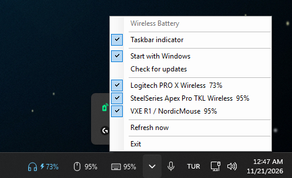

# Wireless Battery 1.5.0

Battery levels of your wireless headset, mouse, keyboard and controller, right on the Windows 10/11 taskbar.

%3A%0ASoftware%20used%20(G%20HUB%2C%20SteelSeries%20GG%2C%20etc.)%3A%0ADevice%20report%20(tray%20menu%20%E2%86%92%20Copy%20device%20report)%3A%0A)

**Download:** https://github.com/cngksy/wireless-battery/releases/latest — `WirelessBattery-Setup.exe` (recommended) or `WirelessBattery-portable.zip`. No GitHub account needed.

**VirusTotal (1.4.5):** [installer: 3/71](https://www.virustotal.com/gui/file/4f586f4611add569e60ad887210f3caa0e69485604e6802589578d96b1425620) · [portable ZIP: 0/66](https://www.virustotal.com/gui/file/9bad84c3049d117841410af8f6359fd88747ae40508e97e71b9dfe20332b71fa). The installer hits are generic machine-learning guesses (e.g. "ObfuscatedPoly") that unsigned installers commonly get, and need review by the antivirus vendors; no major antivirus flags it. If you prefer, use the portable ZIP.

The installer sets the app up for your user account only. It needs no administrator rights and adds a Start menu shortcut and an uninstaller. For portable use, extract the ZIP and run `WirelessBattery.exe`. The app uses the .NET Framework 4.x that ships with Windows.
Before installing or updating, any running copy of Wireless Battery is closed automatically and safely; there is no need to choose Exit from the tray menu first.

## How it works

**Battery indicator on the taskbar.** Battery levels of wireless devices such as headsets, mice and keyboards appear next to the clock, just left of the system icons. A charging device is shown in blue with a ⚡ mark. Batteries at 15% or lower turn red.

**Device details.** Hold the pointer over a device for 1.2 seconds to see its name, battery level, time of the last reading and where the data comes from (G HUB, SteelSeries GG, Bluetooth, etc.).

**Right-click menu.** Right-click the indicator or the tray icon to open the menu. From there you can show or hide each device, turn the indicator off, and manage starting with Windows and update checks. While the menu is open, another left or right click closes it.

## Usage

- Supported devices that report a battery level are detected automatically. The indicator appears on every monitor with a taskbar by default. Use **Show on display** in the right-click menu to toggle individual displays or return to **All displays**. A selected monitor keeps its check mark when unplugged and shows the indicator again when it reconnects and its Windows taskbar is available.
- Hovering over a device shows only that device's name, battery level and last reading.
- Click a device in the right-click menu to show or hide it; the check mark shows its visibility. Choices are saved in `settings.json`.
- Menu order: Taskbar indicator, Show on display and Remember last charge; Start with Windows and Check for updates; device list; Refresh now; Exit.
- If your device does not show up, choose **Copy device report** in the menu. The IDs of connected USB devices are copied to the clipboard; paste the report wherever you want with Ctrl+V. No browser page is opened. The report contains no device paths, serial numbers or Bluetooth device names. It also listens for 10 seconds to the vendor channels of devices that are not supported yet and includes what they send; nothing is sent to any device. For a headset, one report while charging and one while not charging helps the most.
- The app checks GitHub for the latest version 30 seconds after starting and every 6 hours after that. When a new version is out, it shows one notification. Clicking **Check for updates**, **New version: … — Install**, or the update notification downloads the official installer, checks its SHA-256 against the release checksums, and installs it in the background. The app closes during installation, restarts, and confirms the new version with an "Updated successfully" notification. Versions older than 1.4.7 need one final manual update to enable this flow.
- Opening the menu silently refreshes update availability when the last successful check was over five minutes ago.
- When already up to date, the result appears in the update menu item without a Windows notification. New-release and successful-installation notifications remain enabled.
- "Start with Windows" manages the startup entry for your user account; clicking it again removes the check mark and the entry.
- The interface is in Turkish when the Windows display language is Turkish, and in English otherwise.
- A left click or double click does not open a window. Only the app's logo icon sits in the notification area.
- While the right-click menu is open, a left or right click on the icon or the indicator closes it instead of reopening it.
- Device details appear after the pointer rests on the indicator for 1.2 seconds, and never while the menu is open.
- Battery levels refresh automatically every 60 seconds. Taskbar and monitor changes are tracked separately.
- After plugging in a new device, use **Refresh now** to scan right away.
- If Windows reports a system battery, enable **PC battery** from the device list to show it on the taskbar.
- **Remember last charge** is off by default. Enable it to keep disconnected devices' last readings visible in gray, including after an app restart. A known mouse with its receiver plugged in keeps its last reading visible during temporary read failures. Low battery alerts use current readings.

## Device compatibility

**Your device may work even if it isn't listed below.** Wireless Battery automatically looks for battery data on connected devices. Plug in or pair your device, turn it on, and choose **Refresh now** from the tray menu.

### Other devices

- Bluetooth devices that report battery information to Windows
- XInput controllers that report battery information (some show a level such as Low or Full)
- Logitech devices that report battery information through G HUB or HID++ 2.0 on a compatible Unifying, Bolt, Lightspeed, or Nano receiver
- ATK / VXE mice that use a compatible USB receiver

If your device still doesn't appear, [send a device report](#bug-report).

### Approved devices

These models have built-in support in Wireless Battery. Where support depends on the connection or software, that requirement is listed next to the model.

- 8BitDo Ultimate 2 Wireless for PC (2.4 GHz receiver)
- ATK X1 SE
- HyperX Cloud Alpha Wireless
- HyperX Cloud III Wireless
- Logitech G305 LIGHTSPEED
- Logitech G735 LIGHTSPEED
- Logitech PRO X Wireless
- Razer BlackShark V3 Pro (PC USB receiver)
- Sony DualShock 4, DualSense and DualSense Edge (USB or full Bluetooth reports)
- SteelSeries Apex Pro TKL Wireless (requires SteelSeries GG)
- VXE R1 / NordicMouse

### Known limitations

- 8BitDo Ultimate 2C Wireless (no usable battery reading from the tested 2.4 GHz receiver, so the indicator shows `--`)
- Sony DualShock 4, DualSense and DualSense Edge in basic Bluetooth mode (the short reports carry no battery data)

## Bug Report

Is your device not showing up, or showing the wrong battery level? Let us know and we will try to add it:

1. Right-click the Wireless Battery icon and choose **Copy device report** while the device is **not charging**. Note the battery level the device or its own software shows, if you can.
2. Plug the device in to charge and choose **Copy device report** again.
3. Open a [bug report](https://github.com/cngksy/wireless-battery/issues/new?title=Device%20support%3A%20&body=Brand%20%2F%20model%3A%0ABattery%20level%20shown%20by%20the%20device%20or%20its%20software%3A%0A%0AReport%20while%20NOT%20charging%3A%0A%0A%0AReport%20while%20charging%3A%0A%0A) and paste both reports with Ctrl+V, together with the brand and model.

Each report takes about 10 seconds. It contains only device IDs and the data your devices send on their own; no device paths, serial numbers or Bluetooth device names. Nothing is sent to your devices while the report is made. Opening an issue needs a free GitHub account.

## Local data and privacy

Battery readings, settings and error/layout logs are written to `%LOCALAPPDATA%\Wireless Battery`. Settings next to an older portable copy are moved there automatically on first run. The shared ZIP and the installer contain no personal settings or device reports.
Depending on your menu choice, the app can add or remove a Windows startup entry for the current user only. It uploads no data, downloads and installs an update only when you click the update action, and never changes device settings or firmware.
It uses GitHub's public API (api.github.com) to check this project's latest version. When you request an update, it also downloads the installer and checksums from this repository's release assets. No device, battery or personal information is sent. To turn off automatic checks, set `"CheckUpdates"` to `false` in `settings.json`.
Only local devices, the G HUB WebSocket at 127.0.0.1:9010 and the 127.0.0.1 GG HTTPS services listed in `coreProps.json` are read. Remote servers, proxies or redirects are not accepted for the GG address; GG's local self-signed certificate is allowed for that request only.
The EXE is built locally and is not digitally signed, so no antivirus can be guaranteed to stay silent. If Windows SmartScreen warns you, choose "More info → Run anyway".

## Source code and building

The complete corresponding source code is in this repository; every release also has a "Source code" archive. `build.ps1` uses the C# compiler that ships with Windows. The logo and icon sources are in the `assets` folder.

    .\build.ps1
    .\WirelessBattery.exe --test
    .\WirelessBattery.exe --scan
    .\WirelessBattery.exe --render
    .\WirelessBattery.exe --report

The installer is built with Inno Setup 6 from `installer.iss`.

`--test` writes the behavior checks to `test-results.txt`. `--scan` writes local device and battery reports, then exits. `--render` draws a small preview of the indicator from the current report. `--report` writes the same device report as the menu item to `device-report.txt`.

## License and references

The application code is GPL-3.0-or-later. The full license is in the `LICENSE` file.
Protocol references:
- BatteryHub / Wireless Device Battery Monitor: https://github.com/krisgfx9/Wireless-Device-Battery-Monitor
- Logitech HID++ / Solaar: https://github.com/pwr-Solaar/Solaar
- Sony controller input reports: https://github.com/torvalds/linux/blob/master/drivers/hid/hid-playstation.c
- Windows system battery: https://learn.microsoft.com/en-us/windows/win32/api/winbase/ns-winbase-system_power_status
- Logitech G735 HID protocol and USB capture by erzhenin-alex: https://github.com/erzhenin-alex/Wireless-Device-Battery-Monitor/commit/6ff09641e99b68b647f034f2ed91cb6aac75c292
- HeadsetControl: https://github.com/Sapd/HeadsetControl
- 8BitDo Ultimate 2C receiver: https://github.com/ascendedent/8bitdo-Linux-Software/blob/main/spec/protocol.md
- 8BitDo Ultimate 2 Wireless battery protocol: https://github.com/MiguelSanzBr/8bitdo-ultimate2-linux/blob/main/docs/PROTOCOL.md
- 8BitDo gamepad input report: https://github.com/notjiccu/wireless-device-battery-monitor/blob/main/src/drivers/eightbitdo.cpp
- Razer BlackShark V3 Pro receiver protocol: https://github.com/openrazer/openrazer/issues/2838
- HyperX Cloud Alpha Wireless receiver protocol: https://github.com/FedeltaMedia/hyperx-cloud-alpha-battery
- HyperX Cloud III Wireless battery protocol: https://lists.openwall.net/linux-kernel/2026/10/22/2247 and https://github.com/LennardKittner/HyperHeadset
- LogiBAT local G HUB messages: https://github.com/someweirdhuman/LogiBAT
- Microsoft documentation for Windows XInputGetBatteryInformation and SetupAPI.

The logo was created with the built-in image_gen tool. The source PNG, the multi-size ICO and the generation prompt are in the `assets` folder.
