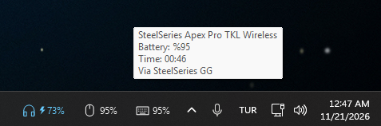

# Wireless Battery 1.4.2

Windows 10/11 x64 için taşınabilir kablosuz cihaz pil göstergesi.

%3A%0AKullan%C4%B1lan%20yaz%C4%B1l%C4%B1m%20(G%20HUB%2C%20SteelSeries%20GG%20vb.)%3A%0A)

**İndir:** https://github.com/cngksy/wireless-battery/releases/latest — `WirelessBattery-Setup.exe` (önerilen) veya `WirelessBattery-portable.zip`.

Önerilen yöntem WirelessBattery-Setup.exe ile kullanıcı hesabına kurmaktır. Yönetici izni istemez, Başlat menüsü kısayolu ve kaldırıcı oluşturur. Portable kullanım için ZIP dosyasını çıkarıp WirelessBattery.exe dosyasını açmak da mümkündür. Windows'un .NET Framework 4.x bileşenlerini kullanır.
Kurulum ve güncelleme başlamadan önce çalışan Wireless Battery örneği otomatik ve güvenli biçimde kapatılır; kullanıcının tray menüsünden ayrıca Çıkış seçmesi gerekmez.

## Nasıl çalışır

**Görev çubuğunda pil göstergesi.** Kulaklık, mouse ve klavye gibi kablosuz cihazların pili saatin yanında, sistem simgelerinin hemen solunda görünür. Şarj olan cihaz mavi renkte ve ⚡ işaretiyle gösterilir. %15 ve altındaki pil kırmızıya döner.

**Cihaz ayrıntısı.** Fareyi bir cihazın üstünde 1,2 saniye tutunca cihazın adı, pil yüzdesi, son ölçüm saati ve verinin kaynağı (G HUB, SteelSeries GG, Bluetooth vb.) açılır.

**Sağ tık menüsü.** Göstergeye veya bildirim alanındaki simgeye sağ tıklayınca menü açılır. Buradan cihazları tek tek gösterip gizleyebilir, göstergeyi kapatabilir, Windows ile başlatmayı ve güncelleme denetimini yönetebilirsiniz. Menü açıkken tekrar sol veya sağ tıklamak menüyü kapatır.

## Kullanım

- Pil bildiren destekli aygıtları otomatik tarar ve her monitörün mevcut görev çubuğuna yerleştirir.
- Bir cihazın üstüne gelince yalnızca o cihazın adı, pili ve son ölçümü görünür.
- Sağ tık menüsündeki cihaz adını tıklayarak göster/gizle; tik görünürlük durumudur. Seçimler settings.json dosyasında kaydedilir.
- Sağ tık menüsü sırası: Görev çubuğu göstergesi; Windows açılırken başlat ve Güncellemeleri denetle; cihaz listesi; Şimdi yenile; Çıkış.
- Cihazınız görünmüyorsa menüden **Cihaz raporunu kopyala**yı seçin: bağlı USB cihazlarının kimlikleri panoya kopyalanır ve "Cihaz bildir" sayfası açılır, Ctrl+V ile yapıştırmanız yeterli. Raporda cihaz yolları, seri numaraları ve Bluetooth cihaz adları bulunmaz.
- Uygulama açıldıktan 30 saniye sonra ve sonra her 6 saatte bir GitHub'daki son sürüme bakar. Yeni sürüm varsa bir kez bildirim gösterir ve menüdeki öğe "Yeni sürümü indir" olur; tıklayınca GitHub Releases sayfası açılır. İndirme ve kurulum kullanıcıya bırakılır.
- Windows açılırken başlat seçeneği kullanıcı hesabındaki başlangıç kaydını yönetir; yeniden tıklanınca tik ve kayıt kaldırılır.
- Windows görüntü dili Türkçeyse arayüz Türkçe, diğer sistemlerde İngilizce çalışır.
- Sol tık veya çift tık pencere açmaz. Bildirim alanında yalnızca uygulamanın logo simgesi bulunur.
- Sağ tık menüsü açıksa simgeye veya cihaz göstergesine sol ya da sağ tıklamak menüyü kapatır; yeniden açmaz.
- Cihaz bilgisi, fare göstergenin üstünde 1,2 saniye durunca açılır; menü açıkken gösterilmez.
- Otomatik yenileme aralığı 60 saniyedir. Görev çubukları ve monitör değişiklikleri ayrıca izlenir.
- Yeni cihaz takıldıktan sonra Şimdi yenile ile hemen taranabilir.

## Destek kapsamı

Her marka ve modelin pili okunamaz. Pil verisini hangi yoldan yayımladığına bağlıdır. Bu sürüm şunları tarar:

- Windows'un standart pil özelliğini yayımladığı Bluetooth aygıtları; marka bağımsız.
- Windows XInput uyumlu kablosuz gamepad'ler: sürücü yalnızca dört kademe veriyorsa Boş/Az/Orta/Dolu gösterilir; kesin yüzde uydurulmaz.
- Logitech G HUB'ın yerel API'si üzerinden pil yüzdesi verdiği uyumlu aygıtlar; G HUB arka plan servisi gerekir.
- VXE R1 / NordicMouse ailesi: 3554:F58A alıcı; 3554:F58C ve doğrulanmış 373B:1273 kablolu/şarj bağlantıları üzerinden HID pil okuma.
- Diğer ATK / VXE / Compx alıcıları (VID 3554 ve 373B, örn. ATK X1 serisinin bazı alıcıları): aynı protokolü konuşuyorsa otomatik okunur. Yalnızca doğrulanmış (checksum) yanıt kabul edilir; yanıt vermeyen tanımsız alıcı listede görünmez.
- Logitech PRO X Wireless 046D:0ABA: önce G HUB veya HID++ kesin yüzdesi kullanılır. Bunlar yoksa voltajdan hesaplanan yüzde gösterilir; görev çubuğunda ayrıca `~` işareti eklenmez.
- SteelSeries Apex Pro TKL Wireless: GG'nin yerel durum API'si; GG/Engine arka plan servisleri gerekir.

USB alıcılı diğer üreticilerin özel protokolleri, PlayStation'a özgü pil protokolü ve her kablosuz mikrofon bu sürümde desteklenmez. Windows/G HUB bunların pilini yayımlıyorsa genel okuyucu kullanabilir. Kablolu veya pil bilgisi yayımlamayan cihazlara yüzde atanmamalıdır.

VXE alıcısının boşta kalması 'mouse kapalı' sayılmaz. Geçici ölçüm eksikliğinde alıcı bağlı kaldıkça son gerçek yüzde normal renkte korunur; üzerine gelince bunun son ölçüm olduğu ve saati açıkça görünür. Alıcı çıkarılırsa eski veri en fazla 30 dakika soluk olarak tutulur. Düşük pil uyarıları yalnızca güncel okumalarla verilir. Gizli aygıtlar uyarı oluşturmaz.

## Yerel veri ve paylaşım

Pil raporu, seçimler ve hata/yerleşim raporları `%LOCALAPPDATA%\Wireless Battery` klasörüne yazılır. Eski portable sürümün yanındaki ayarlar ilk çalıştırmada otomatik taşınır. Paylaşım ZIP'i ve kurulum dosyası kişisel ayar veya cihaz raporu içermez.
Uygulama sağ tık menüsündeki seçime göre yalnızca mevcut kullanıcı için Windows başlangıç kaydı oluşturabilir veya kaldırabilir. Veri yüklemez, kendiliğinden güncelleme indirip kurmaz ve cihaz ayarı/firmware değiştirmez.
İnternete yalnızca güncelleme denetimi için çıkar: GitHub'ın herkese açık API'sinden (api.github.com) bu projenin son sürüm numarasını okur. Bu istekte cihaz, pil veya kişisel bilgi gönderilmez. Otomatik denetimi kapatmak için settings.json içinde "CheckUpdates" değerini false yapın.
Yalnızca yerel cihazlar, 127.0.0.1:9010 G HUB WebSocket'i ve coreProps.json içinde tanımlanan 127.0.0.1 GG HTTPS servisleri okunur. GG adresinde uzak sunucu, proxy veya yönlendirme kabul edilmez; GG'nin yerel kendinden imzalı sertifikasına izin yalnızca o isteğe özeldir.
EXE yerelde derlenmiştir ve dijital imzalı değildir; herhangi bir antivirüste sıfır uyarı garantisi verilmez.

## Kaynak kod ve derleme

Tam karşılık gelen kaynak kod WirelessBattery-source.zip içindedir. build.ps1 Windows'un C# derleyicisini kullanır. Gerekli logo/ikon kaynak paketin assets klasöründedir.

    .\build.ps1
    .\WirelessBattery.exe --test
    .\WirelessBattery.exe --scan
    .\WirelessBattery.exe --render

Kurulum dosyası Inno Setup 6 ile `installer.iss` üzerinden oluşturulur.

--test davranış kontrollerini test-results.txt içine yazar. --scan yerel cihaz ve pil raporlarını oluşturup çıkar. --render mevcut raporun küçük gösterge önizlemesini oluşturur.

## Lisans ve kaynaklar

Uygulama kodu GPL-3.0-or-later. Tam lisans LICENSE dosyasında.
Protokol referansları:
- BatteryHub / Wireless Device Battery Monitor: https://github.com/krisgfx9/Wireless-Device-Battery-Monitor
- Logitech HID++ / Solaar: https://github.com/pwr-Solaar/Solaar
- HeadsetControl: https://github.com/Sapd/HeadsetControl
- LogiBAT yerel G HUB mesajları: https://github.com/someweirdhuman/LogiBAT
- Microsoft Windows XInputGetBatteryInformation ve SetupAPI belgeleri.

Logo yerleşik image_gen ile oluşturuldu. Kaynak PNG, çok boyutlu ICO ve üretim istemi kaynak paketin assets klasöründedir.
